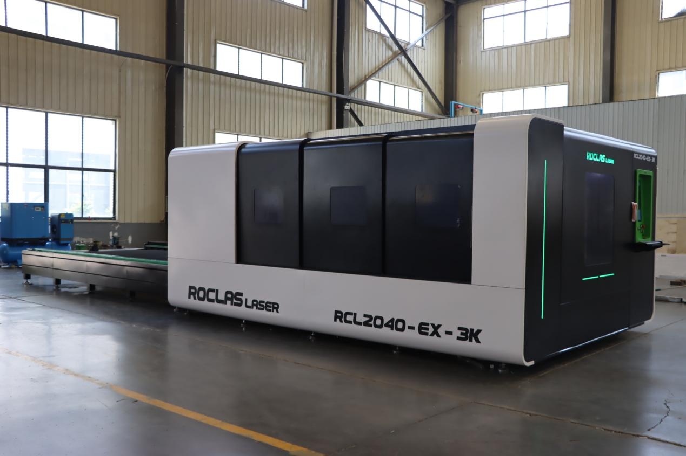
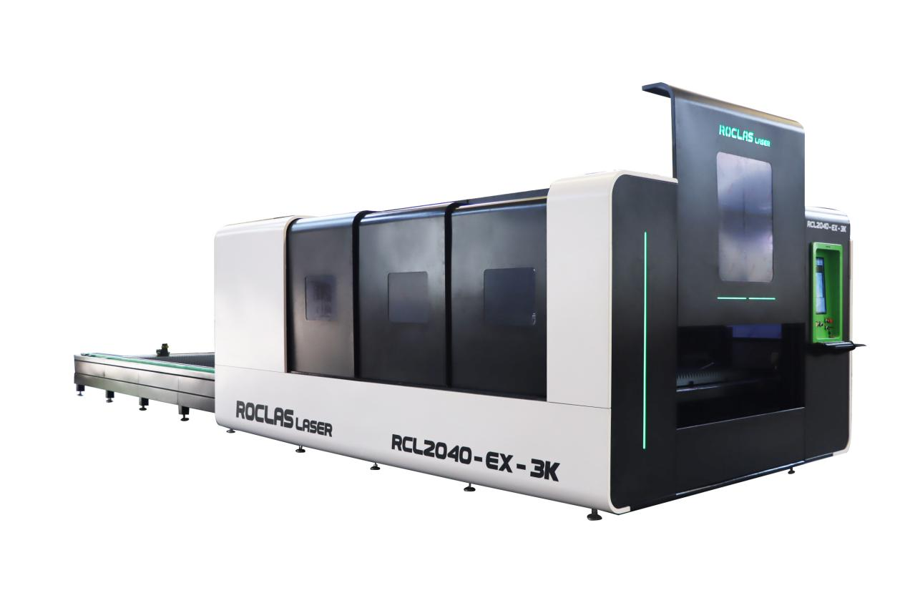
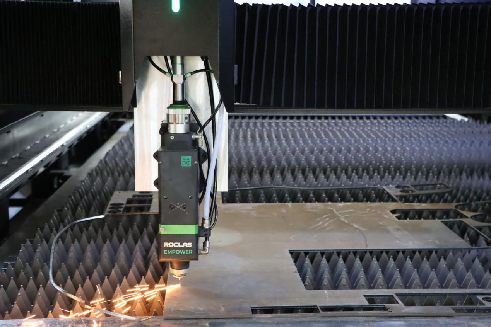
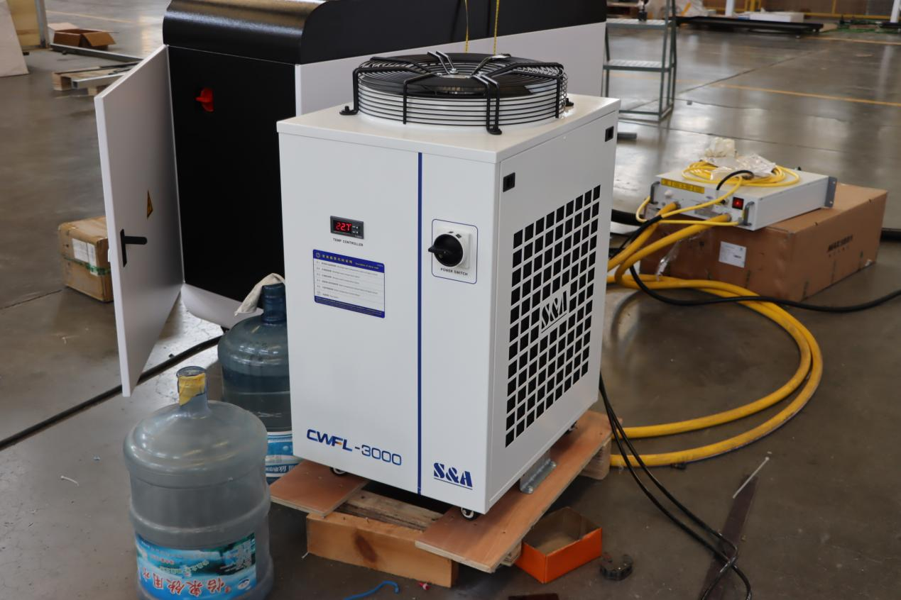
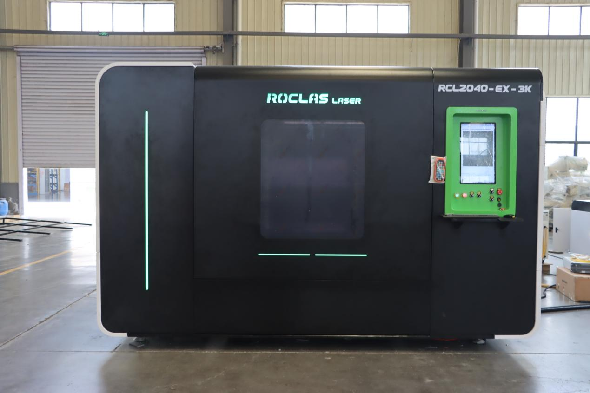
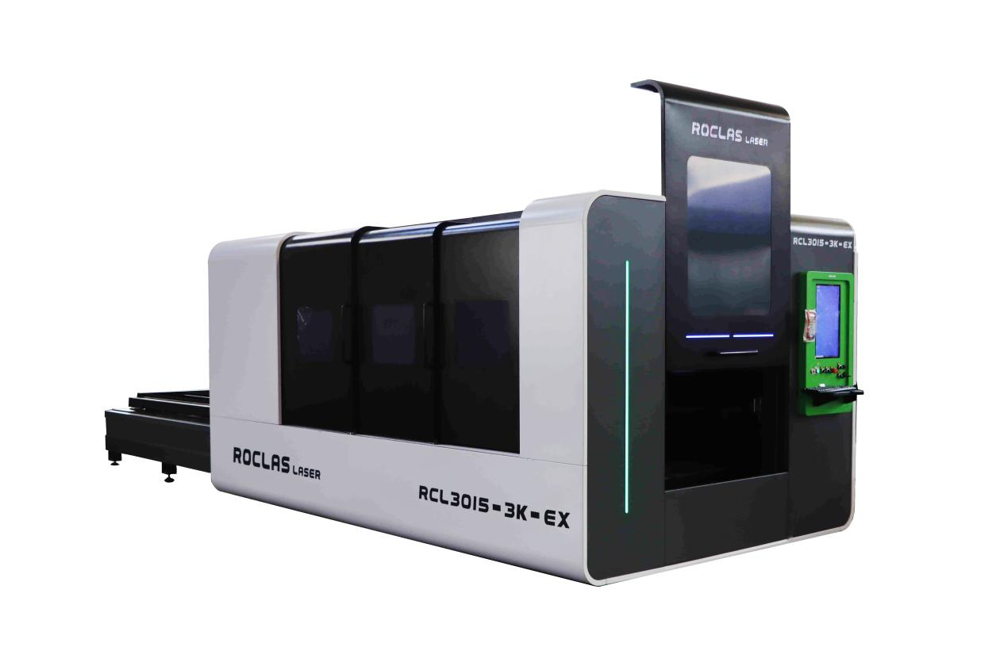

🇩🇿

## RCL2040-EX-3K Laser Cutter: An Algerian Fabricator Moves Up to a 2 × 4 m Exchange Table

Metal · replaced old laser

`Laser 3000W` `Exchange table` `Enclosed`

**Customer**: Metal fabrication shop, Algeria

**Machine**: RCL2040-EX-3K fully enclosed fibre laser with shuttle table

**Worktable**: 2000 × 4000 mm (5 × 10 ft) blade table

**Laser**: 3000W MAX source, RAYTOOLS BS03K head

**Warranty**: 3 years on the complete machine

### Who the customer is

The customer runs a metalworking shop in Algeria and has spent more than ten years cutting and forming sheet metal for local industrial buyers. Most of the workload is carbon steel and stainless plate, and as project volumes grew, the limits of the old equipment started showing up in delivery dates and rework.

### What was slowing them down

  * The old 3-axis laser needed manual loading. Someone had to walk every sheet onto the bed, which pushed up labour cost and stretched the processing cycle.
  * Cut quality had dropped. Edges carried heavy slag, dimensions drifted, and seams never quite lined up, so a lot of parts went back for rework.
  * Speed was the biggest problem. Large orders piled up because the machine simply could not keep pace with the shop's growth.

### What we recommended

We put forward the RCL2040-EX-3K. The shuttle table and the enclosure were the two features that mattered most here.

  * 2000 × 4000 mm interchangeable blade table. A full-size sheet is loaded once, and loading and unloading overlap, so the laser spends its time cutting instead of waiting for material.
  * 3000W MAX source with a RAYTOOLS BS03K head. Edges come out clean and burr-free, well ahead of what their old plasma and laser lines could manage.
  * Fully enclosed body, an S&A 3000W chiller and automatic lubrication. It is built for a hot, dusty production floor.
  * Schneider electrical components throughout and a RAYTOOLS control system, backed by a 3-year machine warranty.

### Key specifications

Model| RCL2040-3K
---|---
Working size| 2000 × 4000 mm (5 × 10 ft)
Working table| Blade table
Laser power| 3K-12K
Laser source| MAX
Laser head| RAYTOOLS
Control system| RAYTOOLS
Max rapid travel| 80,000 mm/min
X/Y axis position accuracy| ±0.03 mm / 1000 mm
Working environment| 0-40 °C, humidity ≤ 80%, no condensation
Working voltage| 220V / 380V, 60/50 Hz, 3PH
Auxiliary gas| Air, oxygen, nitrogen
Water chiller| S&A
Packing size| 9000 × 2250 × 2300 mm
Gross / net weight| 3500 kg / 3250 kg

### Questions the customer asked

**Q: Can it cut copper and aluminium, or do the reflective surfaces cause trouble?**
It handles them. The high-reflectivity suppression module takes 1-2 mm copper and 2-3 mm aluminium without a problem.

**Q: Do we need a dedicated room for it?**
No. A 380V supply and reasonable ventilation are enough, because the smoke extraction is built into the machine.

**Q: Can we program offline?**
Yes. The layout can be prepared on a computer first and sent over later, so the machine is not sitting idle while someone draws the next job.

### A smaller alternative

For a shop that only needs a 3000 × 1500 mm working area, the open-type RCL3015-3K covers the same 3000W cutting work without the enclosure or exchange table.

### Photos from the customer
 Customer photo 1 of 6
 Customer photo 2 of 6
 Customer photo 3 of 6
 Customer photo 4 of 6
 Customer photo 5 of 6
 Customer photo 6 of 6

**ROCTECH note**

ROCTECH swapped a bottleneck for a machine that keeps cutting while the next sheet loads. The Algerian shop had outgrown its old laser; the exchange table and 3-year warranty took the risk out of moving up. When a customer says "my old machine can't keep up," this is the answer — and the spec sheet above is the proof.

Original case: 若泰机器资料/案例文件_整理/激光案例/阿尔及利亚交换台面/ · photos: 6 images in that folder's images/.

[← Back to all cases](cases/)
