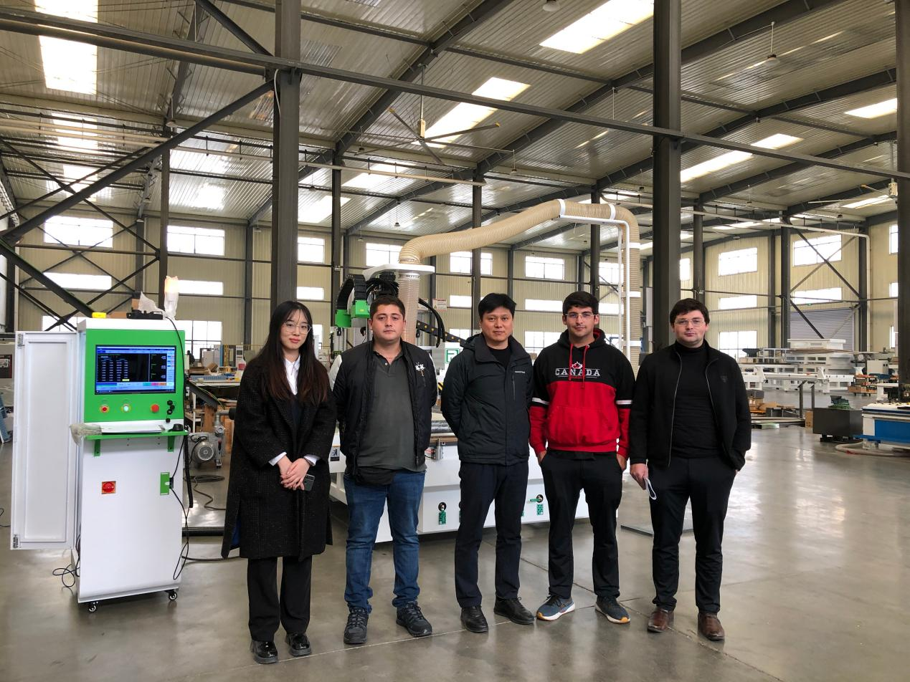
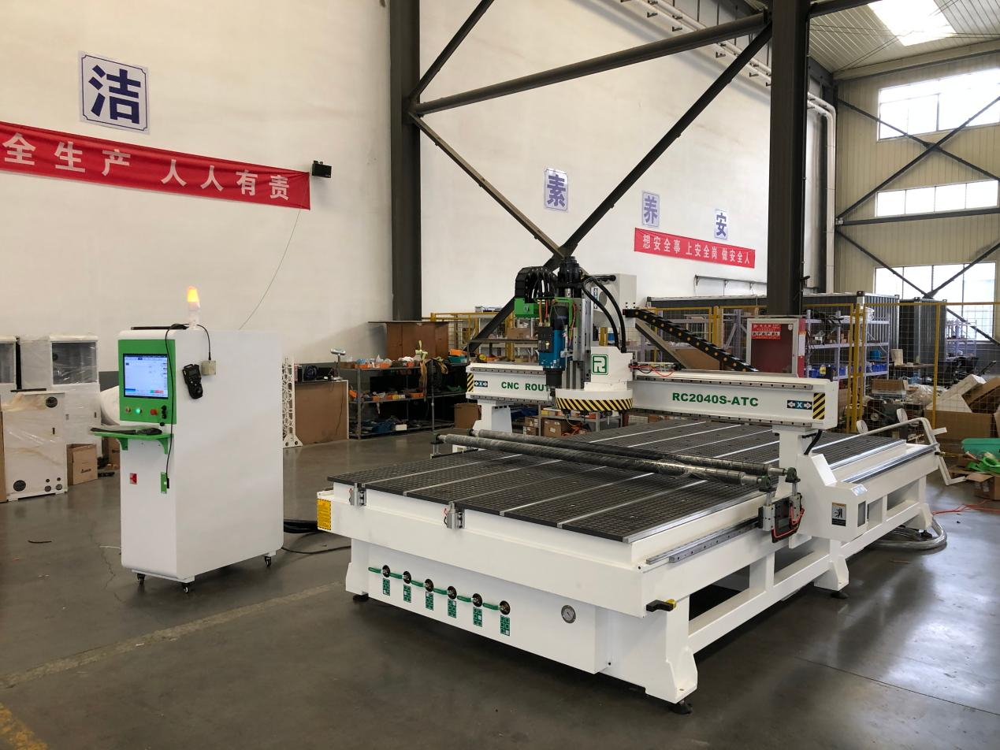

🇨🇱

## A Trusted Partner in Chile: Guillermo's HDPE Processing Line

Plastics / HDPE · repeat buyer

`HDPE` `Repeat buyer`

**Customer**: Guillermo, Chile

**Equipment**: HDPE processing line

**Next purchase**: Dedicated loading and unloading systems

### The customer

Guillermo runs a production business in Chile and bought our HDPE processing equipment to serve the needs of his own customers. The results have spoken for themselves since the first day of production.

### In his own words

"The machine is working very, very well. The product is very good, very clean. The chain is perfect, and the cleaning system runs smoothly in the line. I am very happy with this machine - it was a good choice."

### What has held up

Every core and supporting component runs without issue, and the output quality meets the high standard Guillermo's customers expect. He has already told us he will choose ROCTECH again, this time adding dedicated loading and unloading systems.

We do not treat that as a one-off sale. It is the start of a longer relationship.

### Photos from the customer
 Customer photo 1 of 2
 Customer photo 2 of 2

**ROCTECH note**

Guillermo liked it enough to come back for more — and not just the same machine, but the next step up (loading/unloading automation). That's the kind of repeat business ROCTECH is built on, and it's the cleanest answer to "will this supplier still be there after the sale?" Yes, and they'll sell you the upgrade too.

Original case: 若泰机器资料/案例文件_整理/木工/智利木工案例/ · photos: 2 images + 1 video in that folder's images/.

[← Back to all cases](cases/)
