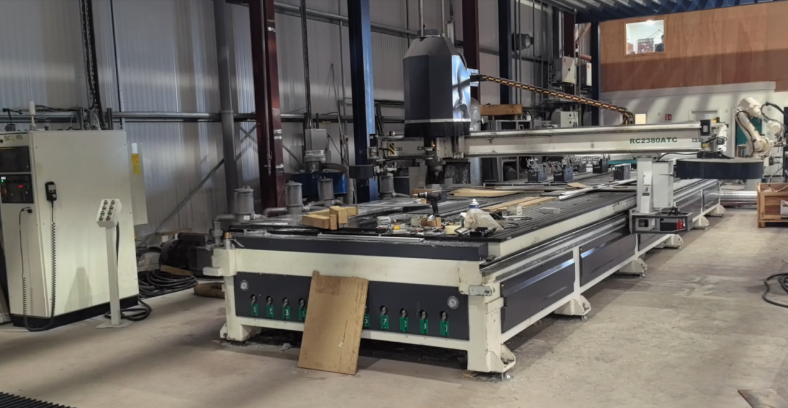
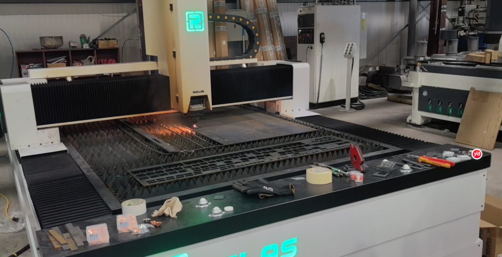
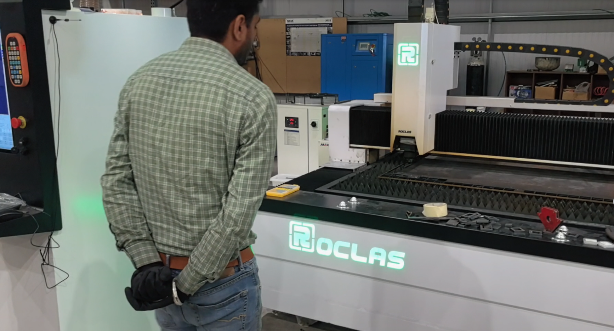
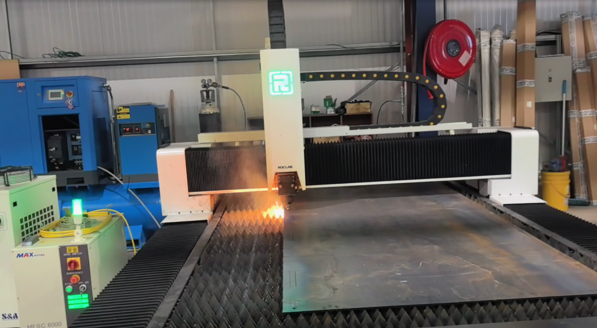

🇮🇪

## From FANUC Routers to ROCLAS Lasers: A Long-Time Customer in Ireland

Woodworking → Laser

`Woodworking` `Laser` `Repeat buyer`

**Customer**: Long-standing woodworking customer, Ireland

**Machine**: 3000W ROCLAS laser

**History**: Previously purchased large FANUC woodworking machinery

### The customer

This customer has been with us since the days of our large FANUC woodworking machines. They believed in the equipment from the start, and when we released the ROCLAS laser series, they did not hesitate. They added a 3000W ROCLAS laser to the workshop and put it straight to work.

### What the feedback shows

The photos they sent back tell the story better than a spec sheet can. Clean cuts and fine engraving that hold every detail of the design, piece after piece, with the same result every time.

They also show a machine that is built to keep going: solid construction and dependable performance, day after day and project after project.

### What it comes down to

High precision, consistent quality and a frame that lasts. From FANUC woodworking machines to ROCLAS lasers, the same customer keeps buying from us, and we keep earning that trust.

### Photos from the customer
 Customer photo 1 of 4
 Customer photo 2 of 4
 Customer photo 3 of 4
 Customer photo 4 of 4

**ROCTECH note**

Same customer, two product families, one supplier. ROCTECH earned the second sale by delivering on the first — the Irish shop ran ROCTECH woodworking machines, trusted the brand, and crossed over to ROCLAS lasers without shopping around. That's brand loyalty you can point to when a laser buyer asks "should I trust a router company to build a laser?" They already did.

Original case: 若泰机器资料/案例文件_整理/木工/爱尔兰激光案例/ · photos: 4 images in that folder's images/.

[← Back to all cases](cases/)
