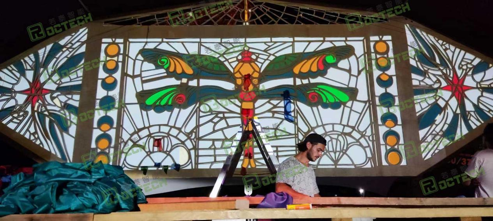
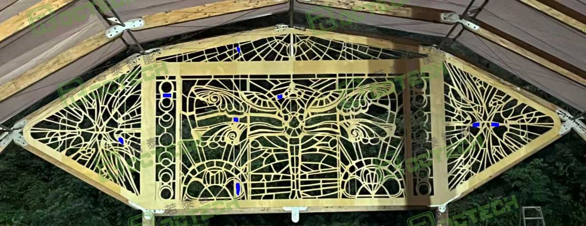
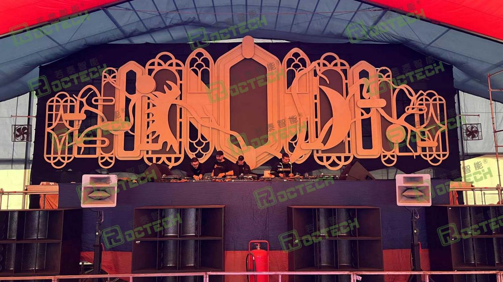

🇷🇴

## Ten Years On: A Romanian Workshop Still Cutting with ROCTECH

Woodworking · 10 years

`Woodworking` `Durability proof`

**Customer**: Woodworking workshop, Romania

**First purchase**: 2016

**Still running**: 10 years and counting

### The customer

A customer in Romania bought our woodworking machinery back in 2016. A decade later those same machines are still turning out work.

### What ten years looks like

The range of work is the proof: gothic-style stage backdrops at music festivals, butterfly-cut lattice panels and glowing carved pavilions. Different jobs, different materials, the same machines day after day.

Ten years of daily use. Ten years of performance without drama. That is what we mean when we talk about ROCTECH durability.

### Photos from the customer
 Customer photo 1 of 3
 Customer photo 2 of 3
 Customer photo 3 of 3

**ROCTECH note**

Ten years on the same machines. ROCTECH doesn't make disposable gear — the Romanian shop is still on the original purchase, not on its third replacement. That's the single strongest durability story in this whole knowledge base, and it's a good one to lead with for any woodworking buyer weighing price against lifespan.

Original case: 若泰机器资料/案例文件_整理/木工/罗马尼亚木工案例/ · photos: 3 images + 1 customer video feedback in that folder's images/.

[← Back to all cases](cases/)
