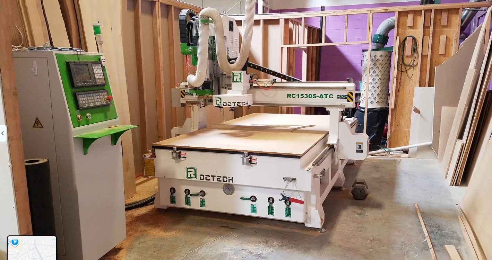
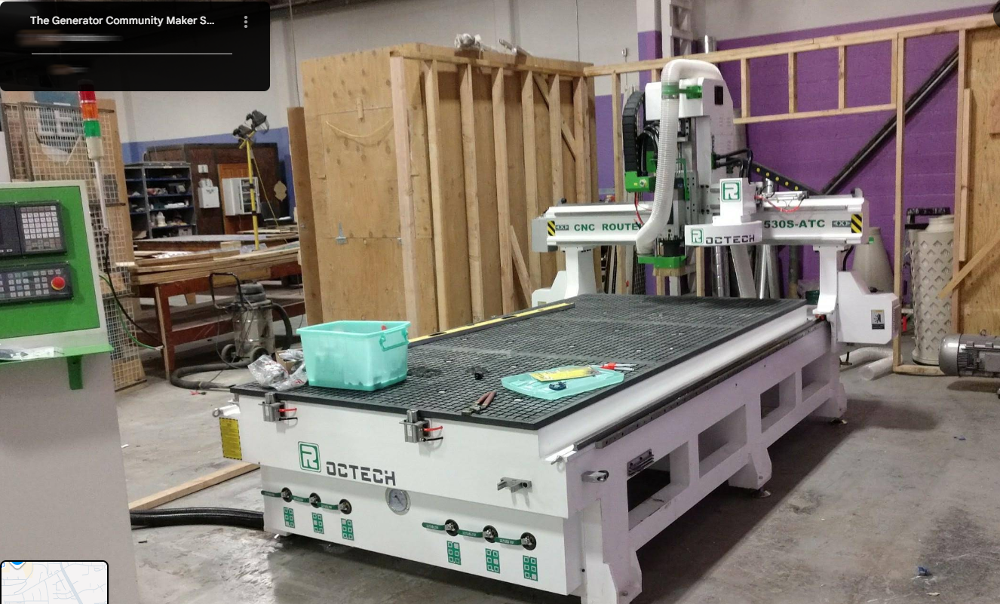
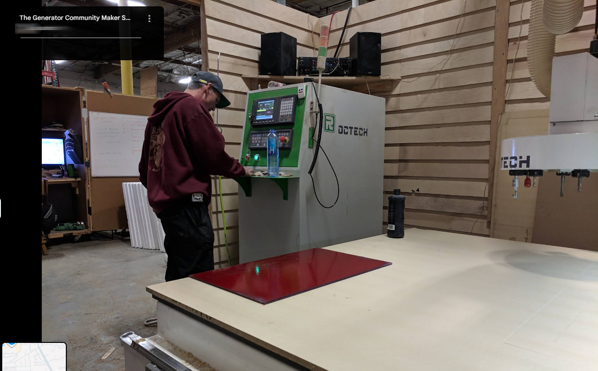
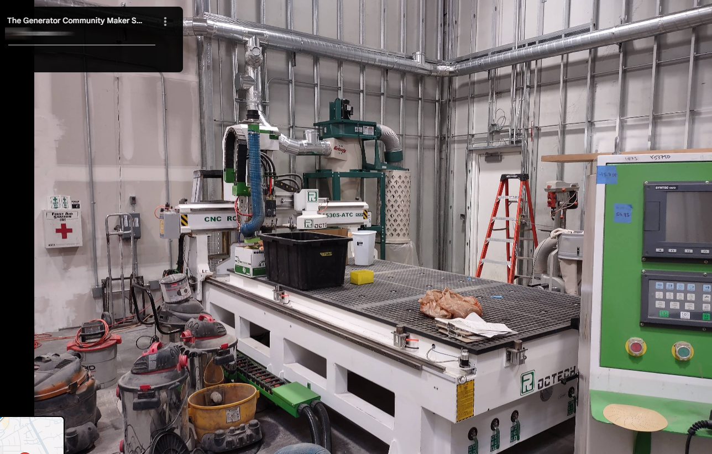

🇺🇸

## A 2017 ROCTECH RC1530S-ATC Still Running at a Nevada Makerspace

Woodworking · installed 2017

`Woodworking` `Makerspace` `Shared equipment`

**Customer**: The Generator Community Maker Space, Reno, Nevada, USA

**Machine**: ROCTECH RC1530S-ATC wood CNC router with ATC

**Installed**: 2017

**Materials**: Solid wood, plywood, MDF and other panels

### The customer

The Generator is a community makerspace in Reno, Nevada. It bought an RC1530S-ATC automatic-tool-change wood CNC router back in 2017, and the machine has been in near-constant use ever since.

### How the machine is used

Because it is a shared public space, the router is operated by many different people every day. It cuts solid wood, plywood, MDF and other panel materials for maker prototypes, custom furniture, sign engraving and general wood fabrication all year round.

Even after years of heavy-duty operation, the router still runs smoothly and holds stable cutting precision. For a machine that has passed through many hands in a public shop, that says a lot about how it was built.

### Key advantages

  * Proven under heavy shared use: many operators, varied jobs and years of continuous running.
  * A durable structure: delivered in 2017 and still holding its rigidity and machining accuracy.
  * ATC automatic tool changer with a vacuum table, for cutting, grooving, routing and engraving.

### Photos from the customer
 Customer photo 1 of 4
 Customer photo 2 of 4
 Customer photo 3 of 4
 Customer photo 4 of 4

**ROCTECH note**

ROCTECH built this machine to survive a public makerspace — handed from one stranger to the next, every day, for years. That's the kind of abuse most shop machines never see, and it's still holding tolerance. If a ROCTECH router can take that, a paid operator's shop is easy.

Original case: 若泰机器资料/案例文件_整理/木工/美国内华达州里诺市木工案例/ · customer photos: 4 images in that folder's images/.

[← Back to all cases](cases/)
